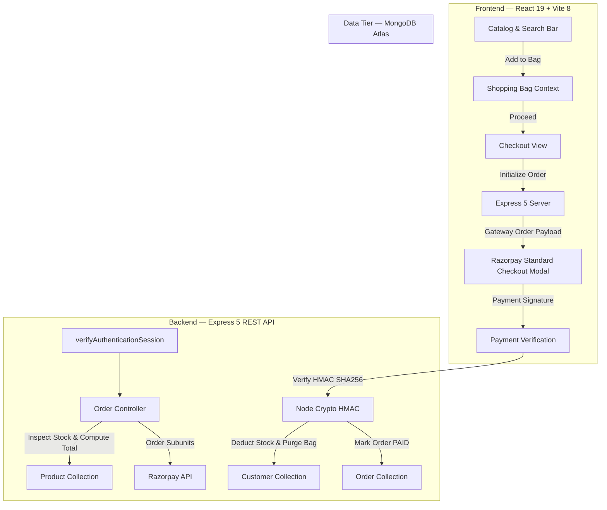
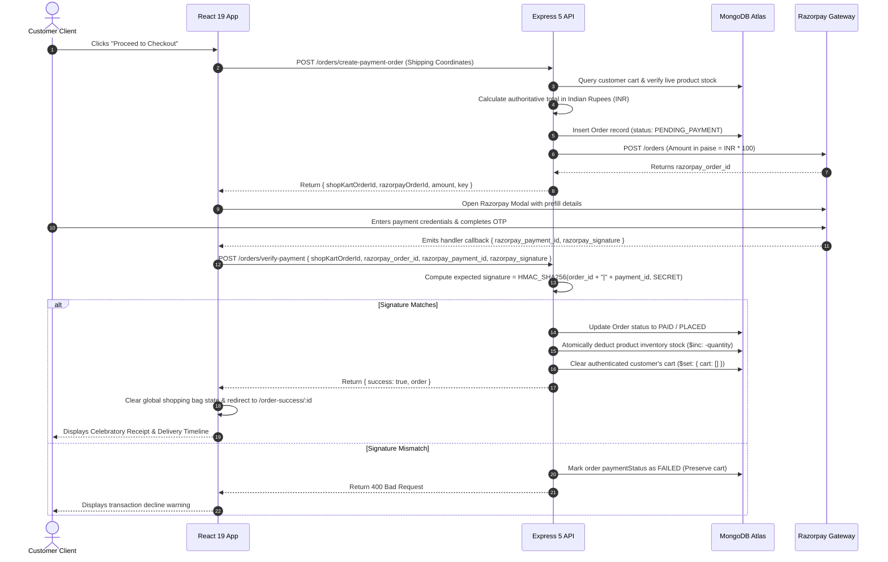

# ShopKart Atelier — Enterprise E-Commerce Platform

[](https://nodejs.org/)
[](https://react.dev/)
[](https://expressjs.com/)
[](https://www.mongodb.com/)
[](https://tailwindcss.com/)
[](https://vitejs.dev/)
[](https://razorpay.com/)

**ShopKart Atelier** is an enterprise-grade, full-stack architectural e-commerce platform engineered with the MERN stack (MongoDB, Express 5, React 19, Node.js 20+). It features an editorial Scandinavian luxury design aesthetic, cryptographic HMAC-SHA256 Razorpay payment gateway integration, secure HTTP-only JWT cookie authentication, server-enforced pricing invariants, real-time cart state synchronization, and an extensive catalog of 50+ curated studio artifacts.

---

## Table of Contents

- [Architectural Overview](#architectural-overview)
- [Design System & UI/UX Philosophy](#design-system--uiux-philosophy)
- [Key Features & Capabilities](#key-features--capabilities)
- [System Architecture](#system-architecture)
- [Cryptographic Payment Flow](#cryptographic-payment-flow)
- [Technology Stack](#technology-stack)
- [Repository Structure](#repository-structure)
- [Database Schema & Entity Models](#database-schema--entity-models)
- [Complete REST API Specifications](#complete-rest-api-specifications)
- [Environment Configuration](#environment-configuration)
- [Installation & Quickstart](#installation--quickstart)
- [Database Seeding](#database-seeding)
- [Security & Engineering Practices](#security--engineering-practices)
- [License](#license)

---

## Architectural Overview

ShopKart Atelier separates concerns into independent, highly cohesive tiers:

1. **Client Tier (React 19 + Vite 8)**: Single-page application styled using modern Tailwind CSS v4 design tokens and custom luxury glassmorphism utilities (`lux-glass-panel`, `lux-card`). Implements reactive global state via React Context (`AuthContext`, `CartContext`), client-side form validations, dynamic SDK script injection, and responsive mobile drawers.
2. **Server Tier (Express 5 + Clean Architecture)**: Decoupled routing layer with centralized asynchronous error handling (`asyncHandler`), standardized JSON response envelopes, CORS whitelist verification, and session authentication via HTTP-only JWT cookies.
3. **Data Tier (MongoDB + Mongoose 9)**: Schema definitions featuring strict referential integrity, compound text search indexes, stock availability safeguards, and purchase-time historical snapshot archives.
4. **Payment Gateway (Razorpay)**: Server-side gateway order generation paired with mandatory client-callback HMAC-SHA256 signature verification.

---

## Design System & UI/UX Philosophy

The interface was redesigned with a **Scandinavian Atelier & Modern Obsidian** aesthetic:

- **Color Palette**:
  - Base Background: Slate Frost (`#F8FAFC`) with pure White floating cards (`#FFFFFF`).
  - Typography: Deep Graphite Obsidian (`#0F172A`) for primary headings, Slate Muted (`#64748B`) for body prose.
  - Accent Color: Electric Indigo (`#4F46E5`), Indigo Glow (`#6366F1`), and Indigo Soft Wash (`#EEF2FF`).
  - Functional Badges: Emerald (`#10B981`) for confirmed stock/success, Rose (`#F43F5E`) for saved wishlist, and Amber (`#F59E0B`) for inventory alerts.
- **Micro-Interactions**:
  - Image hover lift with smooth scaling.
  - Heartbeat pulse on saved wishlist toggling.
  - Live progress meter tracking qualification for complimentary express shipping (threshold ₹999).
  - Floating modal dialogs with escape-key and backdrop-click dismissal.
  - Fast-fill demo credentials generator for zero-friction testing.

---

## Key Features & Capabilities

### 🛍️ Curated Catalog & Search Engine
- **50+ Seeded Artifacts**: Distributed across Electronics, Fashion, Home & Living, Books, Wellness, and Workspace.
- **Server Query Pipeline**: Full case-insensitive regex search, category filtering, and bidirectional price sorting (`price_asc`, `price_desc`).
- **Real-Time Inventory Safeguards**: Live badges displaying "Only X Left", "Sold Out", or warehouse stock counts.

### 💖 Wishlist Management
- **Persistent Mongoose Relationship**: 1-to-N referential association between customer documents and product ObjectIds.
- **Atomic Toggle Endpoint**: Single idempotent mutation endpoint adding or ejecting saved products with visual heartbeat feedback.
- **One-Click Move to Bag**: Effortless transition from saved wishlist directly into the active shopping bag.

### 🛒 Synchronized Shopping Bag
- **Database & Session Sync**: In-memory shopping bag backed by persistent subdocument arrays in MongoDB.
- **Stock Boundary Protection**: Add, increment, and quantity update operations cross-validate available warehouse inventory.
- **Derived Financial Values**: Real-time evaluation of total unit counts, subtotal, and dynamic free shipping qualification.
- **Promotional Vouchers**: Built-in promotional discount simulator supporting privilege vouchers (e.g. `WELCOME10`).

### 💳 Cryptographic Checkout & Orders
- **Authoritative Server Pricing**: Independent re-calculation of all item prices directly against MongoDB records, preventing client-side price tampering.
- **Purchase-Time Historical Snapshots**: Titles, unit prices, quantities, and thumbnail URLs are copied into immutable order records.
- **Cryptographic Signature Verification**: Payments confirmed only upon server-side HMAC-SHA256 digest matching against `RAZORPAY_KEY_SECRET`.
- **4-Stage Delivery Tracking**: Interactive lifecycle visual progression: `PLACED` ➔ `CONFIRMED` ➔ `SHIPPED` ➔ `DELIVERED`, complete with a developer status advance simulator.

---

## System Architecture



---

## Cryptographic Payment Flow



---

## Technology Stack

| Layer | Technology | Version | Purpose |
| :--- | :--- | :--- | :--- |
| **Frontend Framework** | React | `^19.2.8` | Single-page reactive user interface |
| **Bundler & Tooling** | Vite | `^8.2.2` | High-speed ESM development and production build |
| **CSS & Design System** | Tailwind CSS | `^4.3.3` | Utility-first responsive styling and theme tokens |
| **Routing** | React Router DOM | `^7.18.2` | Declarative client-side routing & route guards |
| **HTTP Client** | Axios | `^1.20.0` | Promise-based HTTP client with credential interceptors |
| **Backend Runtime** | Node.js | `>=20.0.0` | Server runtime environment |
| **API Framework** | Express | `^5.2.1` | RESTful API server routing & middleware engine |
| **Database** | MongoDB / Mongoose | `^9.9.5` | Document database with schema enforcement |
| **Authentication** | JSON Web Tokens (JWT) | `^9.0.3` | Secure stateless HTTP-only session tokens |
| **Cryptography** | bcrypt | `^6.0.0` | Salted password hashing (10 salt rounds) |
| **Payment Gateway** | Razorpay SDK | `^2.9.8` | End-to-end checkout and payment processing |

---

## Repository Structure

```
ShopKart-main/
├── README.md                      # Comprehensive architectural documentation
├── backend/
│   ├── package.json               # Backend dependencies and scripts
│   ├── index.js                   # Express server entry point, CORS, and health checks
│   ├── seed.js                    # Database seeder with 50+ curated products
│   ├── config/
│   │   └── razorpay.js            # Razorpay SDK client singleton initialization
│   ├── controllers/
│   │   ├── customerController.js  # Registration, login, session profile, logout
│   │   ├── product.controller.js  # Catalog query, category filter, price sort
│   │   ├── cart.controller.js     # Cart synchronization, stock validation
│   │   ├── wishlist.controller.js # Wishlist toggling and population
│   │   └── order.controller.js    # Razorpay order generation & HMAC signature verification
│   ├── middlewares/
│   │   ├── authMiddleware.js      # JWT cookie & Bearer token session verifier
│   │   ├── auth.middleware.js     # Backwards-compatible middleware export
│   │   └── error.middleware.js    # Global exception and Mongoose error handler
│   ├── models/
│   │   ├── customerModel.js       # Customer schema, cart subdocs, password exclusion
│   │   ├── user.model.js          # Customer model re-export alias
│   │   ├── product.model.js       # Product schema with compound text search index
│   │   └── order.model.js         # Order schema with historical item snapshots
│   └── utils/
│       ├── apiResponse.js         # Standardized API response envelope helper
│       ├── asyncHandler.js        # Controller wrapper eliminating try/catch blocks
│       └── generateToken.js       # JWT signing utility with expiration rules
└── frontend/
    ├── index.html                 # HTML template with Google Fonts
    ├── package.json               # Frontend dependencies and Vite build scripts
    ├── vite.config.js             # Vite configuration with React and Tailwind v4 plugins
    ├── public/
    │   ├── favicon.svg            # Branded application favicon
    │   └── icons.svg              # Core SVG sprite symbols
    └── src/
        ├── main.jsx               # React DOM root initialization
        ├── App.jsx                # Application route declarations and modal host
        ├── index.css              # Custom design system tokens and glassmorphism utilities
        ├── App.css                # Global smooth scrolling and scrollbar overrides
        ├── axiosCalls/
        │   └── axios.js           # Configured Axios instance with 401 interceptor
        ├── context/
        │   ├── AuthContext.jsx    # User authentication provider and modal controller
        │   └── CartContext.jsx    # Shopping bag state provider and financial calculations
        ├── services/
        │   └── api.js             # Unified REST API service integration functions
        ├── components/
        │   ├── Navbar.jsx         # Responsive elevated glass navigation bar with live counters
        │   ├── ProductCard.jsx    # Modern card with stock badges and instant bag action
        │   ├── CartItem.jsx       # Shopping bag row with custom unit steppers
        │   ├── WishlistCard.jsx   # Saved artifact card with one-click move-to-bag
        │   ├── SearchBar.jsx      # Control deck with category pill rail and sort dropdown
        │   ├── AuthModal.jsx      # Glassmorphic modal with demo credentials autofill
        │   ├── ProtectedRoute.jsx # Route guard enforcing authenticated sessions
        │   └── PublicRoute.jsx    # Route guard redirecting authenticated users to /home
        └── pages/
            ├── Landing.jsx        # Editorial landing page with hero, categories, and catalog
            ├── Home.jsx           # Member command dashboard with action shortcuts
            ├── Products.jsx       # Complete catalog with real-time search & filter rail
            ├── ProductDetails.jsx # Split-screen product view with tabs & instant checkout
            ├── Cart.jsx           # Interactive shopping bag with shipping progress meter
            ├── Checkout.jsx       # Multi-step checkout with live validation & Razorpay modal
            ├── OrderSuccess.jsx   # Celebratory receipt page with delivery estimation
            ├── Orders.jsx         # Order history tracking with 4-stage visual timeline
            ├── Profile.jsx        # Member account center with security specs
            ├── Login.jsx          # Standalone full-page login with demo autofill
            └── SignUp.jsx         # Standalone full-page registration screen
```

---

## Database Schema & Entity Models

### 1. Customer Schema (`customer`)
| Field | Type | Attributes | Description |
| :--- | :--- | :--- | :--- |
| `name` | String | Required, Trimmed | Customer's full name |
| `email` | String | Required, Unique, Lowercase, Indexed | Customer's unique account email |
| `password` | String | Required, Min length 6 | Salted bcrypt hash (10 rounds) |
| `phoneNo` | String | Required, Trimmed | Contact phone number |
| `wishlist` | Array of ObjectIds | Ref: `Product` | Saved products for future checkout |
| `cart` | Array of Subdocuments | Embedded array | Active items with `{ product, quantity }` |
| `createdAt` | Date | Default: `Date.now` | Account registration timestamp |

### 2. Product Schema (`Product`)
| Field | Type | Attributes | Description |
| :--- | :--- | :--- | :--- |
| `name` | String | Required, Trimmed, Indexed | Product title |
| `description`| String | Required, Trimmed | Comprehensive descriptive summary |
| `price` | Number | Required, Min: 0.01, Indexed | Product price in Indian Rupees (INR) |
| `category` | String | Required, Trimmed, Indexed | Realm (Electronics, Fashion, etc.) |
| `image` | String | Required, Trimmed | CDN / Web image URL |
| `stock` | Number | Required, Min: 0, Default: 0 | Available inventory units in warehouse |
| `createdAt` | Date | Default: `Date.now`, Indexed | Creation timestamp |

*Note: A compound text index `{ name: "text", description: "text" }` is maintained for rapid keyword searches.*

### 3. Order Schema (`Order`)
| Field | Type | Attributes | Description |
| :--- | :--- | :--- | :--- |
| `user` | ObjectId | Ref: `customer`, Required, Indexed | Authenticated user who placed the order |
| `items` | Array of Subdocs | Embedded snapshot | Immutable copies of `{ product, name, price, quantity, image }` |
| `shippingAddress`| Subdocument | Embedded | Delivery info: `{ fullName, phone, addressLine1, city, state, pincode }` |
| `totalAmount`| Number | Required, Min: 0 | Authoritative grand total evaluated by server |
| `paymentStatus` | String | Enum: `["PENDING", "PAID", "FAILED"]` | Payment validation state |
| `status` | String | Enum: `["PENDING_PAYMENT", "PLACED", "CONFIRMED", "SHIPPED", "DELIVERED"]` | Order fulfillment lifecycle stage |
| `razorpayOrderId` | String | Indexed | Gateway session order ID |
| `razorpayPaymentId` | String | Indexed | Gateway transaction identifier |
| `createdAt` | Date | Timestamps | Order creation timestamp |

---

## Complete REST API Specifications

### 🔐 Authentication (`/customers`)
| Method | Endpoint | Access | Body Parameters | Success Response | Description |
| :--- | :--- | :--- | :--- | :--- | :--- |
| `POST` | `/customers/register` | Public | `name, email, password, phoneNo` | `201 Created` | Creates account, sets HTTP-only JWT cookie |
| `POST` | `/customers/login` | Public | `email, password` | `200 OK` | Validates credentials, sets JWT cookie |
| `POST` | `/customers/logout` | Public | *None* | `200 OK` | Clears authentication session cookie |
| `GET` | `/customers/me` | Private | *None* | `200 OK` | Retrieves current authenticated profile |

### 📦 Product Catalog (`/products`)
| Method | Endpoint | Access | Query / Body Parameters | Success Response | Description |
| :--- | :--- | :--- | :--- | :--- | :--- |
| `GET` | `/products` | Public | `search, category, sort` | `200 OK` | Fetches filtered & sorted catalog |
| `GET` | `/products/:id` | Public | *None* | `200 OK` | Retrieves single product by ObjectId |
| `POST` | `/products` | Public | `name, description, price, category, image, stock` | `201 Created` | Registers new product in catalog |

### 🛒 Shopping Bag (`/cart`)
| Method | Endpoint | Access | Body Parameters | Success Response | Description |
| :--- | :--- | :--- | :--- | :--- | :--- |
| `GET` | `/cart` | Private | *None* | `200 OK` | Fetches populated cart with stock info |
| `POST` | `/cart/:productId` | Private | *None* | `200 OK` | Adds product or increments quantity |
| `PATCH` | `/cart/:productId`| Private | `quantity` | `200 OK` | Updates unit count (checks inventory) |
| `DELETE`| `/cart/:productId`| Private | *None* | `200 OK` | Removes product from shopping bag |

### 💖 Wishlist (`/wishlist`)
| Method | Endpoint | Access | Body Parameters | Success Response | Description |
| :--- | :--- | :--- | :--- | :--- | :--- |
| `GET` | `/wishlist` | Private | *None* | `200 OK` | Retrieves user's populated saved pieces |
| `POST` | `/wishlist/:productId` | Private | *None* | `201 Created` | Adds product to saved wishlist |
| `DELETE`| `/wishlist/:productId` | Private | *None* | `200 OK` | Ejects product from wishlist |
| `PATCH` | `/wishlist/:productId/toggle` | Private | *None* | `200 OK` | Idempotent toggle (adds or removes) |

### 💳 Orders & Payments (`/orders`)
| Method | Endpoint | Access | Body Parameters | Success Response | Description |
| :--- | :--- | :--- | :--- | :--- | :--- |
| `POST` | `/orders/create-payment-order` | Private | `shippingAddress` | `200 OK` | Validates stock, calculates total, creates Razorpay order |
| `POST` | `/orders/verify-payment` | Private | `shopKartOrderId, razorpay_order_id, razorpay_payment_id, razorpay_signature` | `200 OK` | Verifies HMAC signature, marks PAID, clears cart |
| `GET` | `/orders` | Private | *None* | `200 OK` | Fetches user's order history (newest first) |
| `GET` | `/orders/:id` | Private | *None* | `200 OK` | Fetches single order details with ownership verification |
| `PATCH` | `/orders/:id/status` | Private | `status` | `200 OK` | Developer simulator to advance order status |

---

## Environment Configuration

Create a `.env` file in the `backend/` directory:

```env
# Server Network Port
PORT=8001

# MongoDB Connection String (Atlas or Local)
dbUrl=mongodb+srv://<username>:<password>@cluster0.mongodb.net/shopkart?retryWrites=true&w=majority
# Alternative fallback key supported:
MONGODB_URI=mongodb+srv://<username>:<password>@cluster0.mongodb.net/shopkart?retryWrites=true&w=majority

# JWT Authentication Secret
JWT_SECRET=your_super_secure_jwt_secret_key_minimum_32_characters

# Razorpay Payment Gateway Credentials (Test or Production)
RAZORPAY_KEY_ID=rzp_test_yourKeyIdHere
RAZORPAY_KEY_SECRET=yourRazorpayKeySecretHere

# Client Application URL (For CORS Whitelist)
CLIENT_URL=http://localhost:5173
```

*(Optional)* Create a `.env` file in the `frontend/` directory if connecting to a custom backend host:

```env
VITE_API_URL=http://localhost:8001
```

---

## Installation & Quickstart

### Prerequisites
- [Node.js](https://nodejs.org/) v20.0.0 or higher
- [npm](https://www.npmjs.com/) v10.0.0 or higher
- Active MongoDB database connection (local MongoDB daemon or MongoDB Atlas cluster)

### 1. Clone & Install Dependencies

```bash
# Clone the repository
git clone https://github.com/your-username/ShopKart.git
cd ShopKart-main

# Install backend dependencies
cd backend
npm install

# Install frontend dependencies
cd ../frontend
npm install
```

### 2. Seed the Catalog Database

Populate your MongoDB database with the 50+ curated products:

```bash
cd backend
npm run seed
```

Output:
```
Connecting to MongoDB for catalog seed...
✓ Connected to MongoDB.
Cleared previous catalog records (0 items).
✓ Successfully seeded 52 distinct products into MongoDB!
Catalog Distribution: { Electronics: 12, Fashion: 11, 'Home & Living': 11, Books: 6, Wellness: 6, Workspace: 6 }
✓ MongoDB gracefully disconnected.
```

### 3. Launch Development Servers

Run the backend Express API server:
```bash
cd backend
npm run dev
# Server listening on http://localhost:8001
```

In a separate terminal window, launch the frontend Vite development server:
```bash
cd frontend
npm run dev
# Application accessible at http://localhost:5173
```

Open your browser to `http://localhost:5173`.

---

## Security & Engineering Practices

1. **HMAC-SHA256 Cryptographic Verification**: Payments are validated exclusively on the server by computing a digest over `${order_id}|${payment_id}` using `process.env.RAZORPAY_KEY_SECRET`. The secret is never exposed to the client.
2. **Authoritative Price Recalculation**: Prices sent from client payloads are strictly ignored during checkout. The server independently queries each product's current database price to evaluate the total, preventing manipulation of product amounts.
3. **HTTP-Only SameSite Cookies**: Authentication tokens are stored in `httpOnly: true, sameSite: "lax"` cookies, protecting credentials from Cross-Site Scripting (XSS) extraction.
4. **Historical Snapshot Accounting**: When an order is created, product titles, unit prices, and thumbnail URLs are duplicated into the order record. Subsequent price changes or product deletions do not alter historical invoices.
5. **Atomic Stock Decrements**: Inventory deductions use Mongoose `$inc: { stock: -quantity }` operations executed only upon validated signature verification.

---

## License

This project is licensed under the [ISC License](LICENSE). Designed and engineered with architectural discipline.
# ShopKart
# ShopKart
